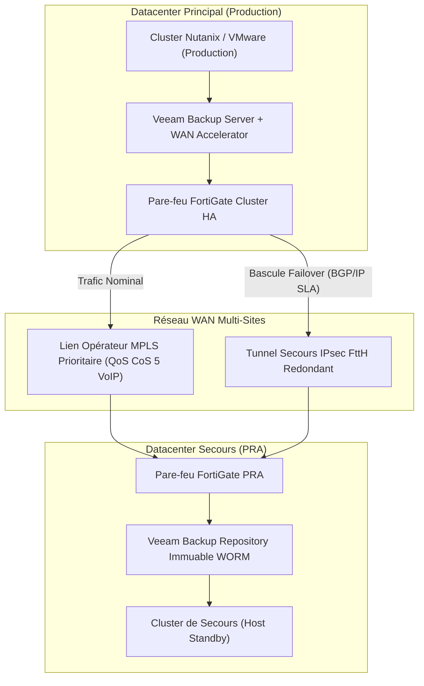
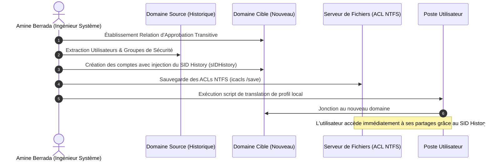
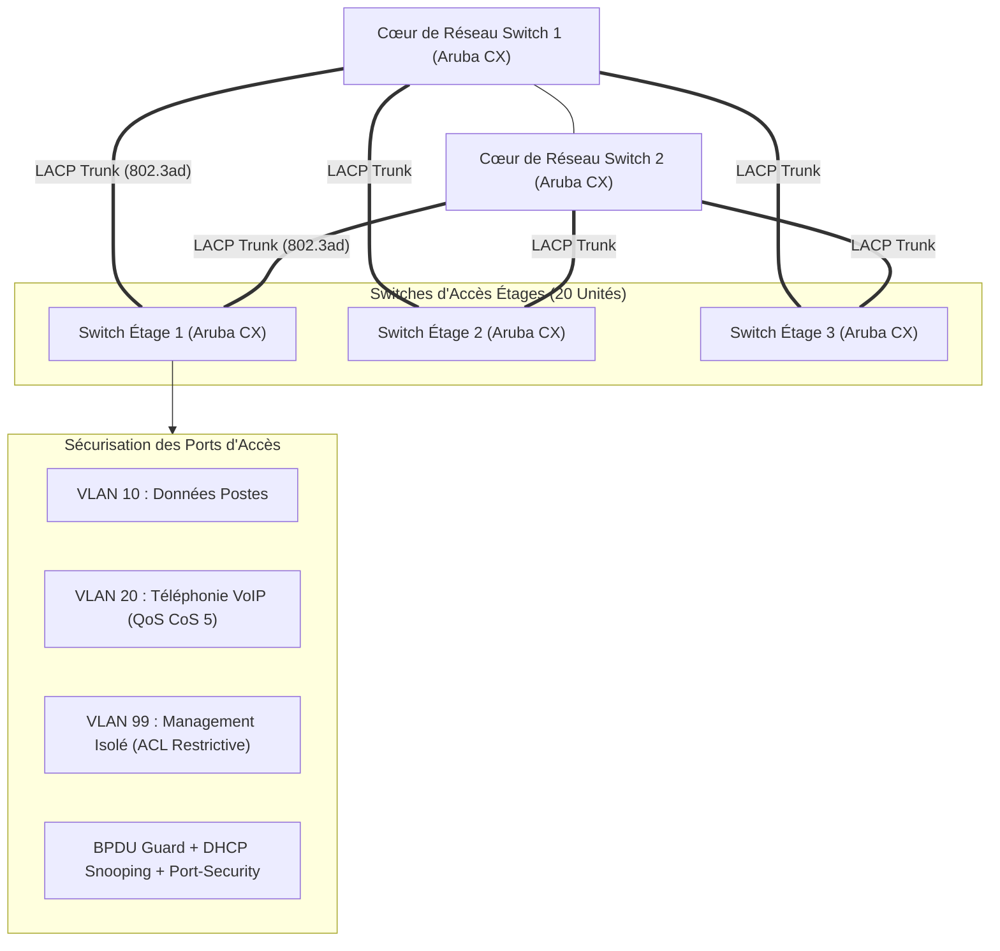
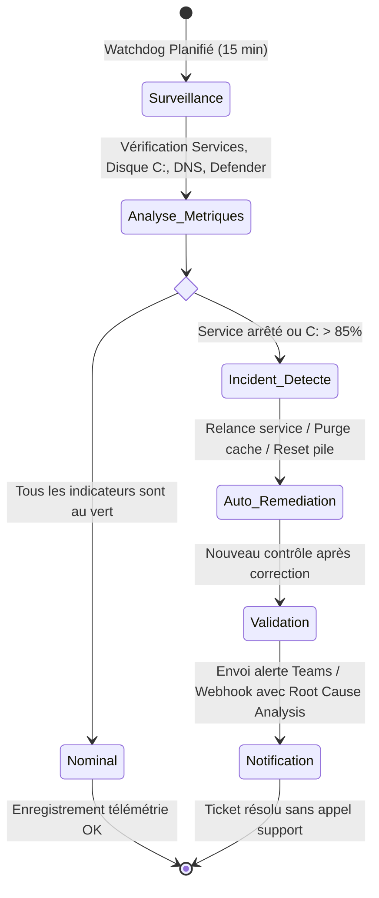

# 📐 SCHÉMAS D'ARCHITECTURE SYSTÈMES, RÉSEAUX & CONTINUITÉ D'ACTIVITÉ

> **Dossier d'Architecture Technique (DAT) • Conçu par Amine BERRADA**  
> *Ces schémas documentent les infrastructures réelles conçues, migrées et opérées au cours de mes missions.*

---

## 1. Architecture Multi-Sites WAN (MPLS / SD-WAN) & PRA Intersites

Ce schéma illustre la topologie réseau opérée avec opérateur télécom, bascule automatique de secours et réplication de continuité d'activité (PRA) :



---

## 2. Architecture de Sauvegarde Résiliente Veeam 3-2-1-1-0 (Anti-Ransomware)

Mise en œuvre chez les grands comptes pour garantir la survie des données face aux menaces avancées :

```mermaid
flowchart LR
    VMs["Machines Virtuelles Production (Hyper-V / VMware / Nutanix)"] -->|Sauvegarde Quotidienne| Repo_Local["Dépôt Primaire Rapide (Baie SAN / SSD)"]
    Repo_Local -->|Copie de Sauvegarde (Backup Copy)| Repo_Linux["Dépôt Immuable WORM (Linux Durci XFS - 30 Jours Verrouillé)"]
    Repo_Local -->|Réplication WAN Accélérée| Cloud_DR["Datacenter Secondaire / Cloud Hybride Air-Gapped"]
    Repo_Linux -->|Vérification Automatique| SureBackup["SureBackup : Démarrage en bac à sable & test d'intégrité (Zéro Erreur)"]
```

---

## 3. Flux de Migration Inter-Domaines Active Directory (Avec SID History)

Processus de bascule sans rupture de service réalisé en autonomie :



---

## 4. Architecture de Commutation d'Entreprise Sécurisée (ArubaOS-CX)

Topologie des 20 switches déployés avec segmentation et protection anti-boucle :



---

## 5. Plateforme AIOps ESN-Toolkit : Cycle d'Auto-Guérison


