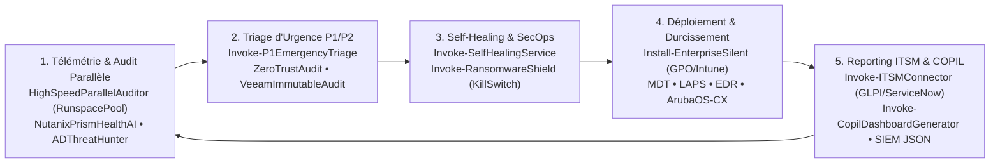

<div align="center">

# 🖥️ ESN-Toolkit & AIOps Platform v3.9 (WSAT Enterprise)

### Autonomous Workstation, Infrastructure, Chaos Engineering & Cloud Operations Platform

**Plateforme PowerShell enterprise d'auto-réparation (Self-Healing), astreinte 24/7 P1/P2, gouvernance COPIL,  
virtualisation (VMware / Nutanix), SecOps Zero-Trust, Chaos Engineering et 7 projets majeurs d'ingénierie.**

---

[](https://github.com/aberrada-engineer/windows-support-automation-toolkit/actions/workflows/ci.yml)


[](https://github.com/aberrada-engineer/windows-support-automation-toolkit)
[](https://www.linkedin.com/in/amine-berrada-infra/)

---

[À propos](#-à-propos) •
[Dossier Entretien & Pitch Deck](#-dossier-technique-dentretien--pitch-deck-interactif) •
[Architecture Modulaire](#-architecture-modulaire) •
[6 Projets Majeurs Déployés](#-6-projets-majeurs-déployés-en-production) •
[Livre Noir des Incidents (REX)](#-le-livre-noir-des-incidents-rex-de-production) •
[AIOps & Astreinte 24/7](#-aiops-astreinte-247--résilience) •
[Interfaces GUI & Console](#-interfaces-graphique--console-interactive) •
[Auteur & Référent](#-auteur--référent-technique)

</div>

---

## 🎯 À propos

**ESN-Toolkit v3.8** est une plateforme d'ingénierie et d'automatisation des opérations informatiques (**AIOps**) conçue pour couvrir l'intégralité du spectre opérationnel d'une DSI ou d'une ESN :
du **support poste de travail (N1/N2)**, à **l'administration système et maintien en conditions opérationnelles (N2/N3)**, jusqu'au **pilotage de projets d'infrastructure critiques (N3 / Architecte)**.

Conçue sur le retour d'expérience de plus de **200 infrastructures multi-clients infogérées** et d'environnements critiques (notamment grands comptes horlogers et luxe genevois tels que *Porsche, TAG Heuer, Hublot*), cette boîte à outils garantit une autonomie opérationnelle maximale.

> ⚡ **100 % Natif Windows (PowerShell 5.1+ & 7+)** — **Zéro dépendance externe** requise — Exécutable immédiatement sur n'importe quel serveur ou poste de travail.

---

## 💼 Dossier Technique d'Entretien & Pitch Deck Interactif

Pour les recruteurs, directeurs techniques (CTO / DSI) et jurys de recrutement, des ressources dédiées sont incluses dans le repository :

- 📄 **[Dossier Technique d'Ingénierie & Guide d'Entretien](Docs/DOSSIER-TECHNIQUE-ENTRETIEN.md)** : Synthèse de ma philosophie d'ingénierie, soutenance approfondie de chaque projet et guide de réponses aux questions d'architecture (AD FSMO, Veeam immuable 3-2-1, Nutanix/VMware, SecOps ANSSI).
- 📊 **[Pitch Deck de Présentation Technique (Slides HTML)](Presentation/index.html)** : Présentation moderne dark mode en 5 diapositives interactive prête à être partagée en visioconférence (Teams / Google Meet).
- 📓 **[Le Livre Noir des Incidents (Compendium REX)](Docs/INCIDENT-LOGBOOK.md)** : 8 études de cas réels d'incidents P1/P2 résolus (symptômes, diagnostic boîte noire, cause racine, remédiation sous astreinte et post-mortem).
- 📐 **[Schémas d'Architecture Système & Réseau (Mermaid)](Docs/ARCHITECTURE-SCHEMAS.md)** : Topologies multi-sites WAN MPLS, clusters virtualisés N+1 et flux de réplication intersites PRA.
- 🧪 **Simulateur Chaos Engineering & Live Demo (`Invoke-IncidentLabSimulator.ps1`)** : 6 scénarios contrôlés incluant tempête DNS/dérive NTP, saturation disque C: 99% et coupure DFS-R/Cluster, avec télémétrie JSON SIEM et `-CleanUp`.

---

## 🔄 Cycle AIOps & Architecture Opérationnelle (Mermaid)



---

## 🏗️ Architecture Modulaire

La plateforme compte **plus de 16 000 lignes de code PowerShell & Batch**, structurées en 4 couches opérationnelles :

```
ESN-Toolkit/
│
├── 🚀 SETUP & INTERFACES UTILISATEUR
│   ├── Setup.bat                          # Installateur 1-clic autonome avec élévation de privilèges
│   ├── Install-ESNToolkit.ps1             # Déploiement silencieux vers C:\ESN-Toolkit, config execution policy & raccourcis
│   ├── Install-EnterpriseSilent.bat       # Script de déploiement de masse pour GPO / Intune Win32 App / SCCM
│   ├── ESN-GUI.ps1 & ESN-Launcher.bat     # Interface Graphique Windows Forms (6 onglets métiers, RichTextBox logs)
│   ├── ESN-Console.ps1 & ESN-Console.bat  # Console Interactive TUI avec 35 options d'administration directe
│   └── WebDashboard/ & Invoke-CentralDashboard.ps1 # Dashboard Web offline Datadog-style avec jauges SVG
│
├── 🤖 AIOPS, AUTO-GUÉRISON & ASTREINTE 24/7
│   ├── Invoke-SelfHealingService.ps1      # Gardien tâche de fond (15 min) : auto-repair services, purge disque, DNS
│   ├── Invoke-P1EmergencyTriage.ps1       # Boîte noire d'urgence P1/P2 : BSOD minidumps, crash events, Flash report
│   ├── Invoke-RansomwareShield.ps1        # KillSwitch d'isolement d'urgence, gel VSS et capture mémoire/forensics
│   ├── Invoke-PredictiveHealthAnalysis.ps1# Calcul prédictif d'épuisement de stockage C: et indicateur d'usure SSD
│   ├── Invoke-HighSpeedParallelAuditor.ps1# Moteur d'audit multi-threadé RunspacePool (500+ serveurs en < 60s)
│   ├── Invoke-ActiveDirectoryThreatHunter.ps1 # Chasseur heuristique AD (Kerberoasting, AS-REP, AdminSDHolder, SIEM JSON)
│   ├── Invoke-DRTest.ps1                  # Simulation PRA/PCA mesurant RTO/RPO avec certificat SLA officiel
│   └── Docs/RUNBOOK-ONCALL-P1-P2.md       # Runbook opérationnel complet d'astreinte 24/7 (GTR < 4h, modèles de crise)
│
├── 🛠️ SUPPORT UTILISATEUR, FLOTTE & MIGRATION
│   ├── Invoke-ZeroTouchProvisioning.ps1   # Provisioning de poste neuf (renommage CLI-%SERIAL%, Winget, TPM BitLocker)
│   ├── Invoke-FullStationMigration.ps1    # Migration A à Z (Données, PST, Profils Wi-Fi avec clés, Mappages, Imprimantes)
│   ├── Invoke-FleetDiscovery.ps1          # Scan réseau multi-threadé /24 (Windows, Linux, Switchs, Imprimantes)
│   ├── Invoke-GLPIInventoryAgent.ps1      # Agent d'inventaire complet matériel/logiciel exportable en JSON/XML pour GLPI
│   └── Invoke-WSUSComplianceManager.ps1   # Audit conformité WSUS, détection hotfixes manquants et resynchronisation
│
├── 🏢 GOUVERNANCE, AUDIT INFRASTRUCTURE, ZERO-TRUST & ITSM
│   ├── Invoke-ZeroTrustAudit.ps1          # Audit maturité Zero-Trust (TPM 2.0, SecureBoot, VBS, LSA PPL, Entra ID)
│   ├── Invoke-ITSMConnector.ps1           # Dispatcher d'alertes & connecteur REST API (GLPI, ServiceNow, Teams)
│   ├── Invoke-COPILReportGenerator.ps1    # Générateur de Rapport Mensuel Exécutif COPIL / COTECH (SLA 99.9%, MTTR)
│   ├── Invoke-CopilDashboardGenerator.ps1 # Générateur de Dashboard COPIL HTML5 dark mode autonome avec graphiques SVG
│   ├── Invoke-DRPGenerator.ps1            # Générateur de Dossier Officiel de Plan de Reprise d'Activité (PRA / DRP)
│   ├── Invoke-PRTGSensorDeployer.ps1      # Déployeur de sondes PRTG Network Monitor avancées (XML/JSON Veeam/Disque/DHCP)
│   ├── Invoke-LinuxHeterogeneousAudit.ps1 # Audit à distance de serveurs Linux (Ubuntu/Debian) via SSH natif Windows
│   ├── Invoke-HypervisorAudit.ps1         # Audit VMware vSphere & Nutanix (Snapshots > 72h, saturation datastores)
│   ├── Invoke-NutanixPrismHealthAI.ps1    # Télémétrie REST Nutanix Prism v2/v3, santé CVM/IOPS & prédiction Runway
│   ├── Invoke-VeeamImmutableAudit.ps1     # Audit d'immuabilité réelle Veeam Hardened Repository (XFS, chattr +i, canari)
│   ├── Invoke-ExchangeHealthCheck.ps1     # Audit Exchange Hybride/On-Premise, files d'attente et contrôle SPF/DKIM/DMARC
│   ├── Invoke-CoreServicesAudit.ps1       # Audit DHCP (saturation scopes), Scavenging DNS et certificats SSL expirant
│   ├── Invoke-CloudHybridAudit.ps1        # Audit Entra ID Connect, Intune MDM et Defender for Endpoint (Sense)
│   ├── Invoke-NetworkApplianceAudit.ps1   # Audit pare-feux FortiGate / Stormshield, tunnels VPN IPsec & sauvegardes conf
│   ├── Invoke-ADHygieneCheck.ps1          # Audit sécurité Active Directory (Comptes inactifs, Domain Admins, PasswordNeverExpires)
│   └── Invoke-InfrastructureSizing.ps1    # Dimensionnement cluster N+1, calcul rétention Veeam 3-2-1 et chiffrage COPIL
│
└── 💼 PROJETS MAJEURS D'INGÉNIERIE (DOSSIER RÉFÉRENT TECHNIQUE)
    ├── Projects/AD-Migration/             # Migration inter-domaines AD (SID History, ACLs NTFS, migration postes)
    ├── Projects/EDR-Deployment/           # Déploiement automatisé d'EDR SentinelOne sur +200 postes avec désinstallation legacy
    ├── Projects/Network-Aruba/            # Générateur de configuration ArubaOS-CX (VLANs, LACP uplinks, BPDU Guard, PRTG)
    ├── Projects/Windows-LAPS/             # Déploiement Windows LAPS, rotation 30j et remédiation Pass-the-Hash
    ├── Projects/Datacenter-Migration/     # Plan de bascule Datacenter et orchestration de failover planifié Veeam
    ├── Projects/MDT-Deployment/           # Industrialisation MDT/WDS (~200 Postes Texdecor, CustomSettings, Total Control drivers)
    └── Projects/WAN-MPLS-Refonte/         # Recette refonte WAN MPLS/SD-WAN et validation des flux de réplication intersites PRA
```

---

## 💼 6 Projets Majeurs Déployés en Production

Ces scripts reproduisent fidèlement les architectures et projets d'envergure menés par **Amine BERRADA** :

### 1. 🔄 Migration Inter-Domaines Active Directory
- **Dossier :** `Projects/AD-Migration/Invoke-ADDomainMigration.ps1`
- **Contexte :** Fusion et consolidation d'infrastructures d'entreprises sans interruption de service.
- **Capacités :**
  - Cartographie et extraction des utilisateurs, groupes de sécurité et ordinateurs du domaine source.
  - Préparation du mapping **SID History** pour préserver les accès aux ressources legacy.
  - Sauvegarde et réplication des listes de contrôle d'accès NTFS (**icacls**) sur les serveurs de fichiers.
  - Script de réassignation de profil local utilisateur pour le poste de travail migrated.

### 2. 🛡️ Déploiement Automatisé d'EDR / Antivirus (+200 Hôtes)
- **Dossier :** `Projects/EDR-Deployment/Invoke-EDRMassRollout.ps1`
- **Contexte :** Remplacement d'antivirus obsolètes par un EDR nouvelle génération (SentinelOne / Defender for Endpoint).
- **Capacités :**
  - Détection et désinstallation silencieuse des anciens antivirus tiers (McAfee, Kaspersky, Symantec, Trend Micro).
  - Validation des prérequis de communication réseau (Cloud Management Console HTTPS 443).
  - Installation silencieuse de l'agent EDR avec injection du **Site Token** d'enregistrement client.
  - Vérification de l'état de démarrage des services et génération de la matrice de conformité du parc.

### 3. 🔌 Déploiement & Configuration de Switchs Aruba (~20 Commutateurs)
- **Dossier :** `Projects/Network-Aruba/New-ArubaSwitchConfig.ps1`
- **Contexte :** Renouvellement et durcissement de l'infrastructure de commutation réseau d'entreprise.
- **Capacités :**
  - Génération automatisée des configurations **ArubaOS-CX** prêtes à être injectées par CLI ou TFTP.
  - Définition des VLANs (Data, Voice avec QoS CoS 5, Management isolé, Guest, DMZ).
  - Agrégation de liens haute disponibilité (**LACP Trunk** uplinks vers le cœur de réseau).
  - Durcissement de sécurité : **Port-Security**, **BPDU-Guard**, **DHCP Snooping**, isolation du Management.
  - Déclaration de l'agent SNMPv3 pour intégration immédiate dans la supervision **PRTG**.

### 4. 🔐 Déploiement Windows LAPS & Durcissement Post-Audit
- **Dossier :** `Projects/Windows-LAPS/Deploy-WindowsLAPS.ps1`
- **Contexte :** Remédiation post-audit de sécurité pour éradiquer les attaques par rebond (**Pass-the-Hash**).
- **Capacités :**
  - Extension du schéma Active Directory pour les attributs LAPS (`ms-Mcs-AdmPwd`).
  - Déploiement de la stratégie GPO / Registre : mot de passe administrateur local unique de 16 caractères complexes.
  - Rotation automatique tous les 30 jours et délégation stricte des droits de lecture aux seuls administrateurs habilités.
  - Audit d'expiration des mots de passe sur l'ensemble des machines de l'annuaire.

### 5. 🏢 Bascule Planifiée de Datacenter & Orchestration Veeam PRA
- **Dossier :** `Projects/Datacenter-Migration/Invoke-VeeamFailoverPlan.ps1`
- **Contexte :** Déménagement d'infrastructures d'hébergement critiques vers un nouveau Datacenter.
- **Capacités :**
  - Synchronisation finale des points de restauration par réplication inter-sites Veeam Backup & Replication.
  - Arrêt propre et ordonné des machines virtuelles sources sur le cluster d'origine.
  - Basculement automatisé (**Planned Failover**) des VMs critiques (Contrôleurs de domaine, SQL, ERP, File Servers).
  - Re-IPing automatique des interfaces réseaux et validation de la connectivité post-bascule.

### 6. 🖥️ Industrialisation MDT / WDS (~200 Postes Déployés)
- **Dossier :** `Projects/MDT-Deployment/Invoke-MDTIndustrialization.ps1`
- **Contexte :** Migration industrielle de ~200 postes (Windows 7 vers 10/11) pour Texdecor Group.
- **Capacités :**
  - Structuration de l'arborescence des pilotes par constructeur (**Total Control** : Dell, HP, Lenovo).
  - Génération des fichiers `CustomSettings.ini` et `Bootstrap.ini` pour un déploiement Zero-Touch.
  - Nommage automatisé selon le numéro de série constructeur (`CLI-%SERIAL%`).
  - Injection des scripts post-installation : purge bloatware, chiffrement BitLocker XTS-256 et intégration LAPS.

### 7. 🌐 Refonte WAN Multi-Sites (MPLS / SD-WAN) & PRA Intersites
- **Dossier :** `Projects/WAN-MPLS-Refonte/Invoke-WANMigrationPlan.ps1`
- **Contexte :** Migration WAN inter-sites, bascule opérateur et sécurisation de la bande passante de réplication Veeam.
- **Capacités :**
  - Audit **MTU Path Discovery** (contrôle du bit DF Don't Fragment pour éliminer le black-holing ICMP).
  - Mesure de la latence moyenne, gigue et taux de perte de paquets vers les sites distants (SLA opérateur).
  - Validation de la connectivité sur le port de réplication Veeam WAN Accelerator (Port 6162).
  - Édition d'un **Procès-Verbal de Recette Opérateur** en HTML.

---

## 🤖 AIOps, Astreinte 24/7 & Résilience

| Module | Fonctionnement | Valeur Métier |
|---|---|---|
| **Invoke-SelfHealingService.ps1** | Exécuté toutes les 15 min via le Planificateur de tâches. Vérifie les services critiques (Spooler, Windows Update, DNS, Defender), purge le disque C: dès 85% d'occupation et réinitialise le DNS si Internet tombe. | **Résout 80% des tickets N1 sans intervention humaine.** |
| **Invoke-P1EmergencyTriage.ps1** | Boîte noire d'urgence pour astreinte P1/P2. Extrait les derniers Minidumps BSOD (`C:\Windows\Minidump`), les 50 derniers événements d'erreurs, l'état SMART et produit un rapport d'incident Flash en moins de 30 secondes. | **Respect strict de la GTR / GTI lors d'incidents critiques P1.** |
| **Invoke-RansomwareShield.ps1** | KillSwitch d'isolement d'urgence. Coupe immédiatement toutes les interfaces réseau, bloque les ports SMB/RDP, protège les clichés instantanés VSS et exporte la liste des processus suspects et connexions actives (`netstat`). | **Endiguement immédiat d'une attaque par ransomware.** |
| **Invoke-PredictiveHealthAnalysis.ps1** | Régression linéaire mathématique sur l'historique d'écriture disque pour prédire le jour exact de saturation du disque C:, analyse l'usure SSD (TBW) et génère une analyse de cause racine (RCA) pré-rédigée pour le ticket. | **Prévention proactive des pannes avant impact utilisateur.** |
| **Invoke-DRTest.ps1** | Simulation d'interruption totale de production. Calcule le RPO réel et le RTO estimé, audite l'immutabilité WORM des sauvegardes Veeam et délivre un Certificat officiel de PRA/PCA pour les audits de certification. | **Garantie de continuité d'activité pour les comités de direction.** |
| **Invoke-NutanixPrismHealthAI.ps1** | Interrogation REST Nutanix Prism v2/v3, diagnostic santé CVM/IOPS/latence et régression linéaire de capacité (Runway) avec rapport COTECH + télémétrie SIEM JSON. | **Anticipation de saturation hyperconvergée AHV/AOS.** |
| **Invoke-ActiveDirectoryThreatHunter.ps1** | Chasseur heuristique sans agent : détection Kerberoasting (RC4 0x17), AS-REP Roasting, `adminCount=1` orphelins, ACLs dangereuses et confinement optionnel `-AutoRemediate`. | **Détection et endiguement SecOps AD en temps réel.** |
| **Invoke-HighSpeedParallelAuditor.ps1** | Moteur RunspacePool multithreadé avec timeouts individuels par machine, capable d'auditer +500 serveurs en moins de 60 secondes sans blocage de file. | **Audit de parc multi-clients à haute vélocité.** |
| **Invoke-VeeamImmutableAudit.ps1** | Vérification d'immuabilité Linux Hardened Repository (XFS `reflink=1`, `chattr +i`, transport non-root et test canari non destructif `EPERM`). | **Certification anti-ransomware des sauvegardes 3-2-1.** |
| **Invoke-CopilDashboardGenerator.ps1** | Génération d'un tableau de bord exécutif HTML5 dark mode 100% autonome (graphiques SVG natifs, SLA P1/P2/P3, MTTR, ratio Self-Healing). | **Livrable exécutif instantané pour COPIL / COTECH.** |

---

## 🏢 Infrastructure, Hyperviseurs & Cloud Hybride

### 🖥️ Clusters de Virtualisation (VMware vSphere & Nutanix)
- **Script :** `Invoke-HypervisorAudit.ps1`
- Analyse de la santé des hôtes ESXi et des nœuds Nutanix AOS/AHV.
- Détection des **snapshots obsolètes (> 72h)** responsables de dégradation majeure des I/O de stockage.
- Alerte sur la surallocation de CPU/vRAM et le seuil de saturation des Datastores VMFS/NFS.

### ✉️ Messagerie Exchange Hybride & Flux SMTP
- **Script :** `Invoke-ExchangeHealthCheck.ps1`
- Contrôle de l'état des services de transport et des files d'attente (**Mail Queues**).
- Détection du phénomène de **Backpressure** (saturation ressource disque/mémoire bloquant l'émission des emails).
- Validation de la délivrabilité et de la sécurité des domaines : contrôle des enregistrements **MX, SPF, DKIM et DMARC**.

### 🌐 Services Cœur de Réseau (Core Services)
- **Script :** `Invoke-CoreServicesAudit.ps1`
- Audit des étendues DHCP : alerte immédiate en cas de saturation de scope (> 85% d'adresses allouées).
- Détection des enregistrements DNS fantômes et validation du scavenging automatique.
- Inventaire des certificats SSL/TLS machine et alerte sur les certificats expirant à moins de 30 jours.

### 📑 Gouvernance COPIL / COTECH Mensuel
- **Script :** `Invoke-COPILReportGenerator.ps1`
- Conçu spécifiquement pour les réunions de gouvernance d'infogérance haut de gamme.
- Calcul en temps réel du taux de disponibilité globale (objectif contractuel **SLA 99.9%**).
- Répartition des tickets par sévérité (**P1 Bloquant, P2 Majeur, P3/P4 Demandes**) et calcul du MTTR.
- Production d'un livrable exécutif HTML intégrant les arbitrages de capacité et les recommandations d'architecture.

---

## 🖥️ Interfaces Graphique & Console Interactive

### 1. Interface Graphique (GUI) — `ESN-GUI.ps1`
Accessible via le lanceur `ESN-Launcher.bat` ou l'exécutable déployé sur le bureau :
- **Onglet 1 : Diagnostics & Auto-Fix** (Audit de santé, remédiation automatique, mode simulation, export ZIP incident).
- **Onglet 2 : Support N1/N2 & Caches** (Spooler, DNS, caches M365 Teams/Outlook/OneDrive, Windows Update, agent GLPI).
- **Onglet 3 : Infra, AD & Serveurs** (Active Directory, VMware/Nutanix, Exchange, DHCP/DNS/PKI, Entra ID, Veeam).
- **Onglet 4 : Migration Poste A à Z** (Sauvegarde complète de profil, restauration en 1-clic, rapports).
- **Onglet 5 : AIOps & SecOps** (Gardien Self-Healing, Zero-Touch Provisioning, durcissement ANSSI, Triage P1, KillSwitch).
- **Onglet 6 : Projets Référents & COPIL** (Boutons d'exécution directe pour les 6 projets majeurs et le rapport exécutif SLA 99.9%).

### 2. Console Interactive (TUI) — `ESN-Console.ps1`
Idéale en session PowerShell distante, PowerShell Direct ou RDP à faible débit :
- **43 options numérotées** couvrant l'ensemble des modules AIOps, SecOps, Chaos Lab et audits multi-threadés.
- Sous-menu dédié `[26]` pour exécuter, auditer ou simuler les 7 projets majeurs.

---

## ⏱️ Runbook Astreinte 24/7 : Résoudre un incident P1 en 8 minutes chrono

| Chrono | Étape | Commande WSAT | Objectif |
|---|---|---|---|
| **00:00 – 01:30** | Triage Boîte Noire | `.\Invoke-P1EmergencyTriage.ps1 -HoursBack 4` | Extraction BSOD Minidumps, 50 dernières erreurs EventLog, SMART & réseau + Flash Report HTML/SIEM |
| **01:30 – 03:00** | Scan Parc Parallèle | `.\Invoke-HighSpeedParallelAuditor.ps1 -ComputerName $servers -MaxConcurrency 64` | Détection des serveurs impactés sur 500+ hôtes en < 60s sans blocage |
| **03:00 – 05:00** | Endiguement Cyber / Heal | `.\Invoke-RansomwareShield.ps1 -WhatIf` ou `.\Invoke-SelfHealingService.ps1` | KillSwitch isolant si compromission, ou auto-réparation services/disque/DNS |
| **05:00 – 07:00** | Vérification SecOps & Backup | `.\Invoke-ActiveDirectoryThreatHunter.ps1` + `.\Invoke-VeeamImmutableAudit.ps1` | Contrôle Kerberoasting/AS-REP & intégrité immuable XFS des sauvegardes |
| **07:00 – 08:00** | Clôture & Communication | `.\Invoke-IncidentAnalysis.ps1 -ExportZip` + `.\Invoke-CopilDashboardGenerator.ps1` | Archive preuves ticket ITSM + restitution COTECH/COPIL |

---

## 🚀 Démarrage Rapide & Déploiement Silencieux en Entreprise

### Option A : Installation interactive en 1 clic
Exécutez `Setup.bat` en tant qu'administrateur :
```cmd
Setup.bat
```
Configure `C:\ESN-Toolkit`, règle l'`ExecutionPolicy`, place les raccourcis et lance l'interface graphique.

### Option B : Déploiement Silencieux de Masse (GPO / Intune Win32 App / SCCM)
```cmd
Install-EnterpriseSilent.bat
```
Ou directement en PowerShell non-interactif :
```powershell
powershell.exe -NoProfile -ExecutionPolicy Bypass -File .\Install-ESNToolkit.ps1 -Silent
```

### Option C : Lancement direct sans installation
```powershell
# Lancer l'interface graphique
powershell.exe -ExecutionPolicy Bypass -File .\ESN-GUI.ps1

# Lancer la console interactive
powershell.exe -ExecutionPolicy Bypass -File .\ESN-Console.ps1

# Lancer l'analyse et l'auto-réparation en ligne de commande
powershell.exe -ExecutionPolicy Bypass -File .\Invoke-IncidentAnalysis.ps1 -AutoFix -OpenReport
```

---

## 👤 Auteur & Référent Technique

**Amine BERRADA**  
*Administrateur Systèmes et Réseaux Confirmé • Référent Technique N3*  
Spécialiste MCO, Cloud Hybride, Virtualisation & Cybersécurité  
Genève (Suisse) · Paris (Île-de-France) · Lille (Hauts-de-France)

- **Email :** [berradapro@outlook.com](mailto:berradapro@outlook.com)
- **LinkedIn :** [linkedin.com/in/amine-berrada-infra](https://www.linkedin.com/in/amine-berrada-infra/)
- **GitHub :** [github.com/aberrada-engineer](https://github.com/aberrada-engineer)

---

## 📜 Licence

Ce projet est sous licence MIT — Utilisation libre pour les professionnels de l'informatique, les ESN et les DSI.
